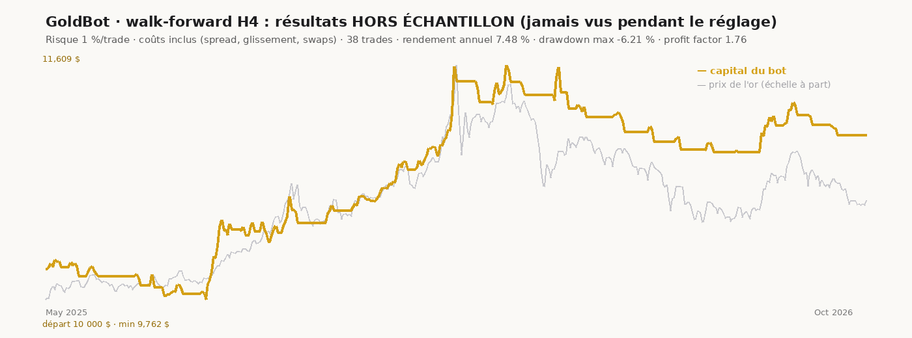

# La recherche derrière GoldBot

Tout a été testé **avec les coûts réels estimés** d'un compte CFD :
- spread de 0,45 $/once et glissement de 0,10 $ ;
- swaps de nuit (-6 %/an à l'achat, -1 %/an à la vente, triple le mercredi) ;
- stop prioritaire si le stop et l'objectif sont touchés dans la même bougie ;
- gaps exécutés au mauvais prix.

Données :
- **or H1 sur 2,4 ans** (mai 2024 → octobre 2026, contrat GC=F) ;
- **or D1 sur 20 ans** (2006 → 2026).

## 1. Les candidates
| Stratégie | Idée | Résultat (risque 1 %/trade) | Verdict |
|---|---|---|---|
| Repli de tendance H1 | entrer sur un retour vers la moyenne dans le sens de la tendance | **-12,9 %** sur 2,4 ans, profit factor 0,87 | ❌ rejetée |
| Cassure du range asiatique H1 | jouer la cassure à l'ouverture de Londres | **-12,2 %** sur 2,4 ans, profit factor 0,89 | ❌ rejetée |
| **Cassure de canal H4** (« Turtles ») | acheter un nouveau plus haut de 20 bougies, laisser courir | **+12 %**, drawdown -6 %, profit factor 1,39 | ✅ retenue |
| Cassure de canal D1 | idem sur 20 ans | quasi plate, plombée par les swaps | ⚠️ trop peu de trades |

Deux idées « classiques » des forums perdent de l'argent une fois les vrais coûts payés. C'est pour ça qu'on teste.

## 2. Robustesse des réglages
30 combinaisons de paramètres de la cassure de canal (canal d'entrée 20/40/55, sortie 10/20, moyenne 50/100/200, stop 2/3 ATR) :
- **H4 : 30 sur 30 rentables** (Sharpe médian 0,52) ;
- **D1 sur 20 ans : 30 sur 30 rentables**.

Aucun « réglage miracle » isolé : toute la zone fonctionne, ce qui réduit le risque d'avoir trouvé un coup de chance.

## 3. D'où vient le gain ?
- **Achats** : nettement positifs (+0,41 R par trade en H4).
- **Ventes** : à peu près nulles. Elles servent de protection : pendant la chute de -45 % de 2012 à 2015, la stratégie D1 ne perd rien.
- **Par régime sur 20 ans** : positive dans 3 régimes sur 5 (2006-11, 2016-19, 2024-26), légèrement négative dans 2. Jamais de catastrophe.

## 4. Une seule amélioration : le filtre de régime
On n'achète que si l'or est au-dessus de sa moyenne de 200 jours, et on ne vend que s'il est en dessous.

| | H4 walk-forward sans filtre | **avec filtre** | D1 20 ans sans filtre | **avec filtre** |
|---|---|---|---|---|
| Rendement annuel | 8,0 % | 7,5 % | 0,7 % | 1,3 % |
| Drawdown max | -6,7 % | **-6,2 %** | -10,2 % | **-5,9 %** |
| Profit factor | 1,50 | **1,76** | 1,31 | **1,76** |
| Espérance / trade | 0,25 R | **0,42 R** | 0,15 R | **0,28 R** |

Le filtre améliore les deux unités de temps sur toutes les périodes : il est activé par défaut.

## 5. Validation walk-forward (le test qui compte)
Le bot choisit ses réglages sur les 12 mois passés, trade les 3 mois suivants **sans les avoir vus**, puis recommence. Résultats hors échantillon, en H4, de mai 2025 à octobre 2026 :

- **+7,5 %/an** à 1 % de risque, **drawdown max -6,2 %**, profit factor **1,76**, Sharpe 1,0 ;
- 38 trades, 50 % de réussite, gain moyen 1,6 R contre une perte moyenne de 0,76 R ;
- les réglages choisis sont **les mêmes presque à chaque fenêtre** (20 / 10 / 200 / 2,0) : signe de stabilité.

## 6. Monte Carlo : le pire probable
5 000 tirages aléatoires de 100 trades (≈ 3 à 4 ans de trading à 2 ou 3 trades par mois), à partir des trades hors échantillon.

**Scénario mesuré** (espérance de 0,42 R par trade, établie sur seulement 38 trades pendant une forte hausse de l'or : **probablement trop optimiste**) :

| Risque par trade | Rendement médian | Drawdown médian | Drawdown mauvais cas (5 %) | Drawdown très mauvais cas (1 %) |
|---|---|---|---|---|
| 0,5 % | +22 % | -3,3 % | -5,9 % | -7,7 % |
| 1 % | +49 % | -6,5 % | -11,6 % | -14,9 % |
| 2 % | +114 % | -12,8 % | -22,1 % | -27,9 % |

**Scénario prudent** (avantage divisé par deux, 0,21 R par trade : **c'est celui-là qu'il faut utiliser pour planifier**) :

| Risque par trade | Rendement médian | Drawdown médian | Drawdown mauvais cas (5 %) | Drawdown très mauvais cas (1 %) | Probabilité de finir en perte |
|---|---|---|---|---|---|
| 0,5 % | +10 % | -5,3 % | -10,0 % | -12,7 % | 12 % |
| **1 %** | **+21 %** | **-10,3 %** | **-19,2 %** | **-23,9 %** | 13 % |
| 2 % | +41 % | -19,9 % | -35,3 % | -42,8 % | 14 % |

À 2 % de risque, un passage à -35 % ou -40 % devient plausible : c'est psychologiquement insupportable pour la plupart des gens, et c'est là qu'on fait des erreurs. **Recommandation : 0,5 % au début, 1 % ensuite.**

## 7. Version H1 pour les petits comptes
Même stratégie, même filtre, unité de temps H1. Les stops sont 2 fois plus courts (~38 $), et le choix robuste des réglages donne les **mêmes paramètres qu'en H4** (20 / 10 / 200 / 2,0).

| Walk-forward H1 hors échantillon (risque 1 %) | |
|---|---|
| Rendement annuel | +17,9 % |
| Drawdown max | -8,5 % |
| Profit factor | 1,62 |
| Trades | 94 (5,6 par mois) |

Simulation d'un **compte cent de 10 $** (hors échantillon, chaque trade au lot minimum) :

| Plafond de risque au lot minimum | Capital final | Rendement annuel | Pire recul |
|---|---|---|---|
| 3 % | 14,96 $ | +34 % | -18 % |
| **5 % (profil par défaut)** | **17,64 $** | **+50 %** | **-23 %** |
| 7 % | 15,82 $ | +39 % | -22 % |

Monte Carlo prudent (avantage divisé par deux, 150 trades) :
- à **3 % de risque** par trade : recul médian -32 %, et -54 % dans le pire cas sur 20 ;
- à **5 %** : recul médian -49 %.

Le profil petit compte est fait pour **démarrer avec très peu**, pas pour placer une grosse somme : au-delà de quelques centaines de dollars, repasse en profil normal (H4, 1 %).

## 8. Limites honnêtes
- **2,4 ans de données intraday seulement**, pendant une période où l'or a beaucoup monté. Il faut **revalider sur l'historique de ton broker** (MT5 HFM donne bien plus d'années) : `goldbot fetch --source mt5`, puis `goldbot walkforward --csv …`.
- Spread, swaps et glissement sont des **estimations** : vérifie-les dans MT5 (clic droit sur XAUUSD › Spécification).
- Une stratégie de tendance a des **séries de pertes** : jusqu'à 8 pertes d'affilée observées, et des mois entiers sans trade. C'est normal, il ne faut pas l'arrêter à la première série.
- **Aucune performance n'est garantie.**
